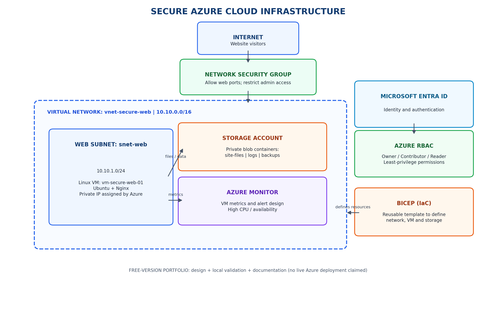

# Secure Azure Cloud Infrastructure

A zero-budget, junior cloud engineer portfolio project that documents a secure Azure web environment. The free version focuses on architecture, Infrastructure as Code (Bicep), local validation, security design, and interview-ready documentation. It does **not** claim that Azure resources have been deployed.

## 1. Project scenario

A fictional small business needs a website hosted on a Linux virtual machine, secure network access, cloud storage for files and backups, identity-based access management, and monitoring.

## 2. Architecture



Planned components:
- Resource group: `rg-secure-web-dev`
- Virtual network: `vnet-secure-web` (`10.10.0.0/16`)
- Subnet: `snet-web` (`10.10.1.0/24`)
- Network Security Group: `nsg-web`
- Linux VM: `vm-secure-web-01` (Ubuntu + Nginx)
- Azure Storage Account: private blob storage for site files, logs, and backups
- Microsoft Entra ID and Azure RBAC: identity and permissions
- Azure Monitor: metrics and alerting design
- Bicep: infrastructure definition

## 3. What each service does

| Service | Purpose |
|---|---|
| Resource group | Logical container for project resources |
| Virtual Network | Private network boundary for Azure resources |
| Subnet | Segments the VNet |
| Network Security Group | Filters network traffic using security rules |
| Virtual Machine | Runs Ubuntu and the Nginx website |
| Storage Account | Stores blob data such as website files and backups |
| Microsoft Entra ID | Identity and authentication service |
| Azure RBAC | Grants permissions at a defined scope |
| Azure Monitor | Collects metrics and supports alerts |
| Bicep | Declarative Infrastructure as Code |

## 4. Network security

See [`security/security-rules.md`](security/security-rules.md).

The intended policy permits web traffic on TCP 80 and 443, and restricts SSH (TCP 22) to a trusted administrator IP range. RDP is not required for this Linux VM. Port 443 requires TLS configuration; an NSG rule alone does not configure HTTPS.

## 5. Identity and access management

Use Microsoft Entra ID for identities and Azure RBAC for authorisation:
- Owner: project administrator only; use sparingly.
- Contributor: approved person who manages resources but does not manage access.
- Reader: person who needs visibility without making changes.

Assign roles at the narrowest appropriate scope (for example, the project resource group). Prefer least privilege, review assignments regularly, and use MFA for interactive accounts. Do not share accounts or store credentials in this repository.

## 6. Monitoring and troubleshooting

Monitoring design:
- Inspect VM metrics such as Percentage CPU.
- Plan an alert for sustained CPU above a chosen threshold (for example, 80%).
- Review VM status and platform health.
- Use boot diagnostics and VM logs when a VM does not start or a service fails.
- For Nginx, check `sudo systemctl status nginx` and relevant logs.
- For network issues, inspect NSG rules, subnet association, NIC configuration, and effective security rules.
- For storage issues, check the identity's data-plane role, container permissions, and storage networking settings.

Azure Monitor, log ingestion, diagnostic settings, and alert notifications can incur costs. Check pricing before enabling paid ingestion or advanced monitoring. These are design and troubleshooting instructions, not evidence of a live test.

## 7. Bicep template

The template is in [`infrastructure/main.bicep`](infrastructure/main.bicep). It defines the NSG, VNet/subnet, public IP, NIC, Linux VM, and Storage Account. It accepts parameters for the storage account name, trusted SSH source prefix, admin username, SSH public key, region, and VM size.

The template is a starting point for learning. Review the selected VM size and Ubuntu image availability in your target region before any deployment. A Standard public IP, VM, disks, and storage can incur charges.

## 8. Local validation

Requirements: Azure CLI with Bicep support.

From the repository root:

```bash
az bicep install
bash scripts/validate.sh
```

This compiles the template locally. Compilation is not the same as a successful Azure deployment. A live deployment also requires an active subscription, permissions, regional capacity, valid parameter values, and budget approval.

## 9. Repository layout

```text
secure-azure-infrastructure/
├── README.md
├── architecture/
│   └── architecture.png
├── infrastructure/
│   └── main.bicep
├── scripts/
│   └── validate.sh
├── security/
│   └── security-rules.md
└── screenshots/
```

Add genuine screenshots to `screenshots/` as you complete local work or any future live deployment. Do not label mockups as Azure deployment evidence.

## 10. Interview explanation

"I designed a secure Azure web infrastructure for a fictional small business. The architecture uses a virtual network, subnet, and Network Security Group to control network access. A planned Ubuntu virtual machine hosts an Nginx website, while a Storage Account holds files and backups. Microsoft Entra ID and Azure RBAC provide identity and least-privilege access management. Azure Monitor is included in the monitoring design, and Bicep defines the infrastructure as code. In the zero-budget version, I built the architecture, documented the controls, and validated the Bicep template locally rather than claiming a live Azure deployment."

## 11. Project status and evidence

Use honest status labels:
- **Designed**: architecture or configuration is documented.
- **Locally validated**: code or files were checked locally.
- **Deployed**: resource was successfully created in Azure.
- **Tested**: the behaviour was actually tested, with evidence.

Do not claim a resource is deployed or a security test passed unless you have performed that deployment or test.

## 12. Cost and cleanup

This version is designed to be completed without deploying paid Azure resources. If you later use Azure credit, estimate costs first, monitor Cost Management, and delete resources when finished. Budgets and alerts are not guaranteed spending caps.
